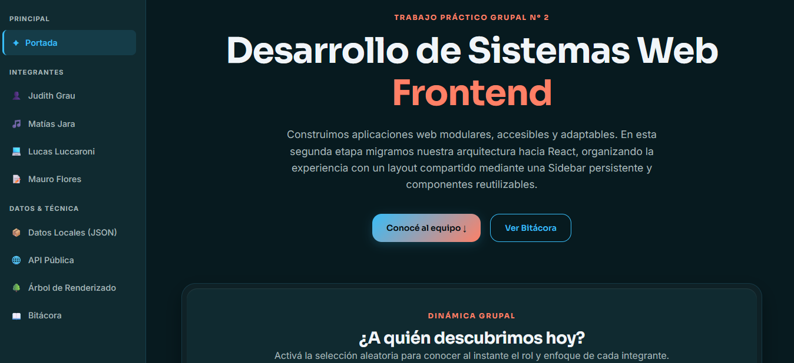
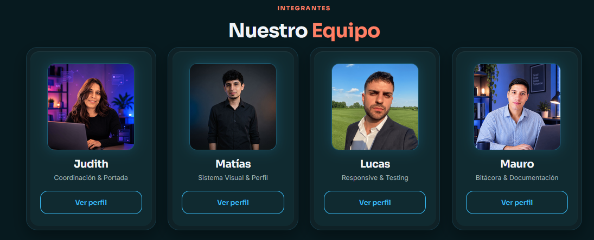
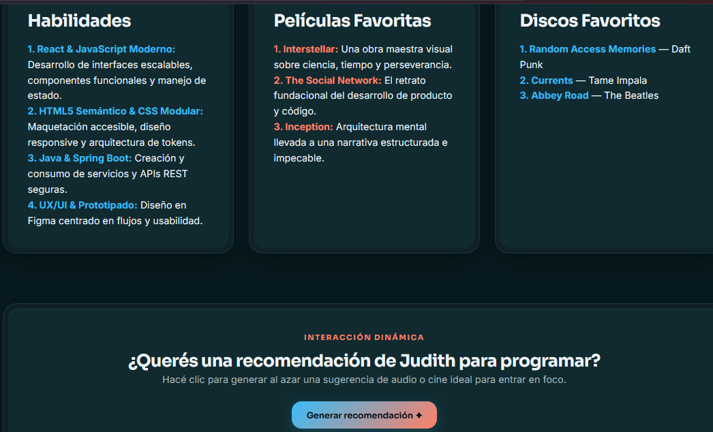
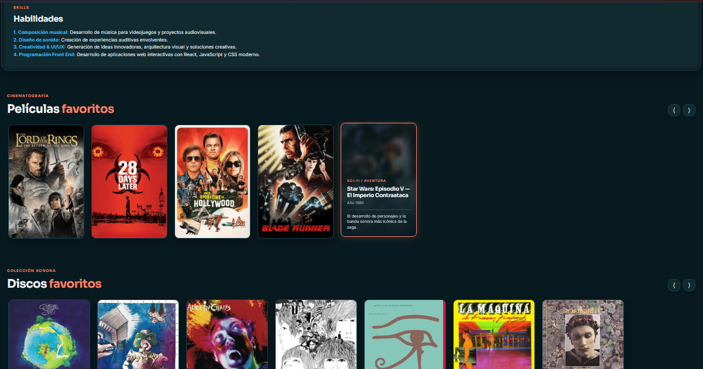
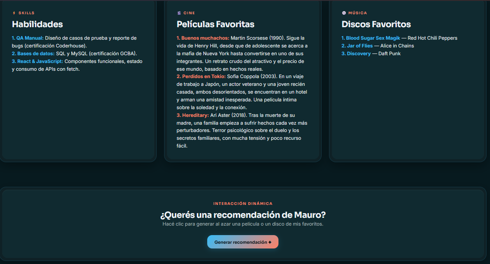
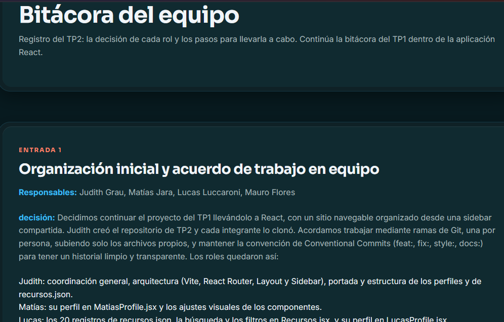
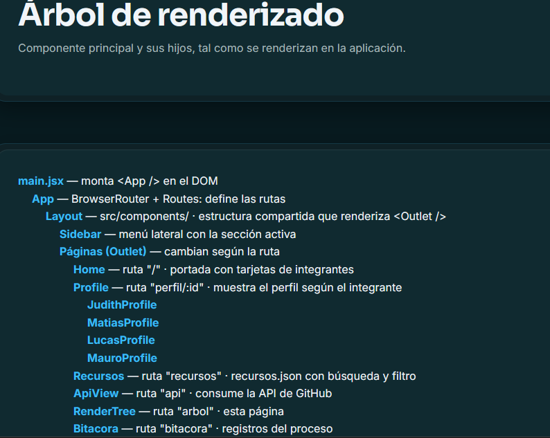
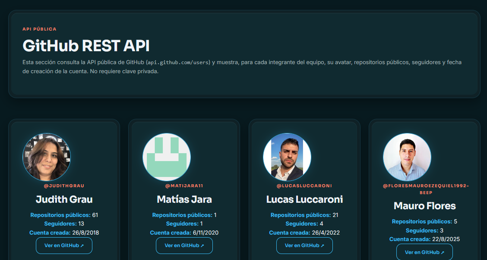

# TP2 - Desarrollo de Sistemas Web Frontend

Aplicación web grupal desarrollada para la materia de Desarrollo de Sistemas Web Frontend (Tecnicatura Superior en Desarrollo de Software, IFTS N°29). El proyecto continúa el sitio del TP1 y lo lleva a React: una aplicación de una sola página con una sidebar compartida, navegación con React Router, perfiles por integrante, datos locales en JSON con búsqueda y filtro, consumo de una API pública, un árbol de renderizado y una bitácora del proceso.

---

## Índice
1. Integrantes del Equipo
2. Tecnologías Utilizadas
3. Secciones y Rutas
4. Guía de Estilos
5. Estructura de Archivos y Carpetas
6. Funciones Dinámicas
7. Datos Locales y API Pública
8. Capturas de pantalla
9. Diseño Adaptativo (Responsive Design)
10. Cómo ejecutar el proyecto
11. Demo
12. Evolución del Proyecto
13. Uso de Inteligencia Artificial y Criterio de Privacidad

---

## Integrantes del Equipo
**Judith Grau** - Coordinación & Arquitectura
- GitHub: github.com/JudithGrau
- Perfil: /perfil/judith
- Responsabilidades: creación del repositorio, base con Vite y React Router, Layout y Sidebar compartida, portada con selector aleatorio de integrantes, modularización de los perfiles y estructura de recursos.json.
**Matías Jara** - Sistema Visual & Perfil
- GitHub: github.com/matijara11
- Perfil: /perfil/matias
- Responsabilidades: sistema visual compartido (style.css), ajustes visuales de los componentes y su perfil con galerías interactivas de películas y discos.
**Lucas Luccaroni** - Datos, Búsqueda & Testing
- GitHub: github.com/lucasluccaroni
- Portafolio: lucasluccaroni-portfolio.vercel.app
- Perfil: /perfil/lucas
- Responsabilidades: los 20 registros de recursos.json, la búsqueda y el filtro en Recursos.jsx, su perfil y las pruebas de adaptabilidad.
**Mauro Flores** - API, Árbol de Renderizado & Bitácora
- GitHub: github.com/floresmauroezequiel1992-beep
- Perfil: /perfil/mauro
- Responsabilidades: consumo de la API en ApiView.jsx, árbol de componentes en RenderTree.jsx, bitácora en Bitacora.jsx, su perfil y la documentación (README).

---

## Tecnologías Utilizadas
- React: interfaz construida con componentes funcionales y hooks (useState, useEffect).
- Vite: entorno de desarrollo y empaquetado del proyecto.
- React Router DOM: navegación entre secciones con BrowserRouter, Routes, Route, NavLink, Outlet y parámetros de ruta (useParams).
- JavaScript (ES6+): manejo de estado, consumo de API con fetch, Promise.all y AbortController.
- CSS3 Vanilla: sistema de tokens de diseño mediante variables personalizadas (:root), composición con Flexbox y CSS Grid, estética double-bezel y glassmorphism, en una única hoja compartida (src/styles/style.css).
- Google Fonts: familias tipográficas Sora (títulos) e Inter (cuerpo de texto).
- GitHub REST API: fuente de datos públicos de los integrantes (sin clave privada).
- ESLint: control de calidad del código.
- Vercel: publicación del sitio.

---

## Secciones y Rutas
| Ruta | Componente | Contenido |
| --- | --- | --- |
| / | Home | Portada del equipo con selector aleatorio de integrantes |
| /perfil/judith | Profile → JudithProfile | Perfil de Judith Grau |
| /perfil/matias |	Profile → MatiasProfile | Perfil de Matías Jara |
| /perfil/lucas | Profile → LucasProfile | Perfil de Lucas Luccaroni |
| /perfil/mauro | Profile → MauroProfile | Perfil de Mauro Flores |
| /recursos	| Recursos | Listado de recursos desde recursos.json, con búsqueda y filtro |
| /api | ApiView | Consumo de la API pública de GitHub |
| /arbol |	RenderTree | Árbol de renderizado de la aplicación |
| /bitacora | Bitacora | Registro del proceso, decisiones por rol y estado de la consigna |

Todas las secciones se alcanzan desde la Sidebar compartida, que muestra la identidad del equipo (TP2 · DevTeam) e indica la sección activa. Los perfiles incluyen además un enlace para volver a la portada, por lo que no es necesario usar el botón Atrás del navegador.

---

## Guía de Estilos
Paleta de Colores (Tokens Hexadecimales)

- Fondo Principal (--color-bg): #071A1F
- Superficie de Tarjetas (--color-surface): #102A30
- Superficie Interactiva (--color-surface-hover): #163840
- Acento Primario Azul (--color-blue): #38BDF8
- Acento Coral / Enlace (--color-coral): #FF8066
- Texto Principal (--color-text): #F1F5F9
- Texto Secundario (--color-text-secondary): #A7B8BA
- Bordes Sutiles (--color-border): rgba(56, 189, 248, 0.15)

---

## Tipografía
- Títulos y Encabezados: Sora, sans-serif.
- Texto General y Párrafos: Inter, sans-serif.
- Escala fluida: tamaños definidos con clamp() para que el texto se adapte al ancho de pantalla.

---

## Componentes reutilizables
- Botones en cuatro variantes: primario (con degradado), secundario, de acento y ghost.
- Contenedor de doble borde (double-bezel) y tarjetas con imagen (card-bezel).
- Etiquetas eyebrow y badges de colores.
- Clases utilitarias de texto y espaciado (text-blue, text-accent, mb-3, mt-4, h-100) y clase sr-only para lectores de pantalla.

---

## Iconografía
- Emojis como íconos de la Sidebar (✦ portada, 👤 🎵 💻 📝 integrantes, 📦 datos, 🌐 API, 🌳 árbol, 📖 bitácora).
- Símbolos puntuales (☰, ✕, ↗, ✦) en botones e interacciones.

---

```
## Estructura de Archivos y Carpetas
tp2-desarrollo-sistemas-web-frontend/
├── public/                     # Archivos estáticos
├── index.html                  # Documento base de Vite
├── package.json                # Dependencias y scripts
├── vite.config.js              # Configuración de Vite con el plugin de React
├── eslint.config.js            # Configuración de ESLint
├── README.md                   # Documentación del proyecto
│
└── src/
    ├── main.jsx                # Punto de entrada: monta <App /> e importa style.css
    ├── App.jsx                 # BrowserRouter y definición de rutas
    │
    ├── components/
    │   ├── Layout.jsx          # Estructura compartida: Sidebar + Outlet
    │   └── Sidebar.jsx         # Menú lateral con NavLink y sección activa
    │
    ├── pages/
    │   ├── Home.jsx            # Portada del equipo
    │   ├── Profile.jsx         # Elige el perfil según el id de la ruta
    │   ├── Recursos.jsx        # Listado JSON con búsqueda y filtro
    │   ├── ApiView.jsx         # Consumo de la API pública
    │   ├── RenderTree.jsx      # Árbol de renderizado
    │   ├── Bitacora.jsx        # Bitácora del proceso
    │   └── profiles/
    │       ├── JudithProfile.jsx
    │       ├── MatiasProfile.jsx
    │       ├── LucasProfile.jsx
    │       └── MauroProfile.jsx
    │
    ├── data/
    │   └── recursos.json       # 20 registros mostrados dinámicamente
    │
    ├── assets/                 # Imágenes y fotos del equipo
    └── styles/
        └── style.css           # Hoja compartida: tokens, componentes y diseño responsive
```

---

## Funciones Dinámicas
1. Portada (Home) — Selector Aleatorio de Integrantes

Permite seleccionar al azar un integrante del equipo y muestra una tarjeta destacada con avatar, rol, descripción y acceso directo a su perfil, sin recargar la página.

2. Perfil de Judith — Generador de Recomendaciones

Genera de forma aleatoria recomendaciones de música o cine para sesiones de programación, evitando repetir la anterior.

3. Perfil de Matías — Galerías de Scroll Horizontal

Galerías de películas y discos con desplazamiento horizontal mediante botones, tarjetas con efecto hover y una capa informativa que revela título, artista, datos y una reseña breve.

4. Perfil de Lucas — Interacción propia y Galerías

Incorpora dos carruseles horizontales interactivos para películas y discos favoritos con control de límites, además de un widget dinámico aleatorio que sugiere recomendaciones de cine o música del catálogo personal evitando repeticiones inmediatas.

5. Perfil de Mauro — Recomendación Aleatoria

Un botón que elige al azar una de las películas o uno de los discos favoritos de Mauro y lo muestra en pantalla.

6. Recursos — Búsqueda y Filtro

Búsqueda por texto y filtro por categoría sobre el listado de recursos.json; ambos actualizan los resultados al instante y se muestra un mensaje cuando no hay coincidencias.

7. API Pública — Estados de Carga y Error

Consulta en paralelo la API de GitHub, muestra un mensaje mientras carga y otro con el detalle si la consulta falla.

---

## Datos Locales y API Pública

Datos locales (JSON)

El archivo src/data/recursos.json reúne 20 registros relacionados con la propuesta del equipo. Recursos.jsx los importa y los muestra de forma dinámica en tarjetas.

---

## API pública: GitHub REST API
- Endpoint: https://api.github.com/users/{usuario}
- Información que aporta: avatar, repositorios públicos, seguidores y fecha de creación de la cuenta de cada integrante.
- Sin claves privadas: la API se consulta directamente desde el navegador.
- Estados: mensaje de carga mientras se esperan los datos y mensaje de error si falla la consulta o un usuario no existe.
- Implementación: useEffect con fetch y Promise.all, y un AbortController para cancelar la consulta al salir de la página.

---

## Capturas de pantalla










---

## Diseño Adaptativo (Responsive Design)

La hoja src/styles/style.css responde a tres breakpoints: 1200px, 900px y 400px.

- Desktop / Base (1200px):
 - Contenedor centrado con límite de ancho y márgenes laterales.
 - Sidebar fija a la izquierda y contenido principal a la derecha.
 - Grilla de integrantes con columnas flexibles.
- Tablet / Pantallas Medianas (900px):
 - La Sidebar se convierte en un menú lateral oculto que se abre con un botón ☰ y se cierra al tocar fuera (fondo con desenfoque).
 - Grilla de integrantes en 2 columnas.
 - Hero de los perfiles en columna y centrado.
 - Tarjetas de las galerías de películas y discos más compactas.
- Mobile (400px):
 - Grilla de tarjetas en 1 columna.
 - Menor espaciado, títulos más chicos y tarjetas de galería ajustadas.
 - Botones con alto mínimo de 44px para uso táctil.
 - Escala tipográfica fluida con clamp().

---

## Cómo ejecutar el proyecto
bash
git clone https://github.com/JudithGrau/tp2-desarrollo-sistemas-web-frontend.git
cd tp2-desarrollo-sistemas-web-frontend
npm install
npm run dev

El sitio se abre en http://localhost:5173. Para generar la versión de producción: npm run build.

---

## Demo

🔗 [Link vercel](https://tp2-desarrollo-sistemas-web-fronten.vercel.app/)

---

Evolución del Proyecto

El TP1 fue un sitio en HTML, CSS y JavaScript sin librerías, con un archivo por perfil y un sistema de diseño propio (tokens de color, estética double-bezel y tipografías Sora e Inter). En el TP2 el equipo conservó esa identidad visual y la llevó a React:

- Las páginas HTML pasaron a componentes reutilizables, con un Layout y una Sidebar compartidos.
- La navegación entre archivos se reemplazó por React Router, con una ruta por sección y un único Profile que elige el perfil según el integrante.
- Se sumaron datos locales en JSON con búsqueda y filtro, el consumo de una API pública con estados de carga y error, un árbol de renderizado y la bitácora integrada a la navegación.
- La dinámica de trabajo pasó a ramas individuales por integrante y Conventional Commits (feat:, fix:, style:, docs:).

---

## Uso de Inteligencia Artificial y Criterio de Privacidad
En cumplimiento con la sección didáctica y transversal del trabajo práctico:

- Aplicaciones utilizadas:
 - Antigravity (asistente de código dentro del editor).
 - Claude (aplicación web de Anthropic).
- Modelos utilizados:
Claude: Sonnet 5.5
Antigravity: Gemini 3.8 Flash High

---

## Uso por integrante:
 
**Judith Grau**
- Aplicación:
- En qué contenido o tarea:

**Matías Jara**		
- Aplicación: Antigravity (Google DeepMind)
- En qué contenido o tarea: 
  1. *Arquitectura CSS y Design Tokens (src/styles/style.css):* Asistencia en la extracción y consolidación de tokens de diseño en :root (paleta extendida con variantes de transparencia, escala de espaciado modular Mobile First y escala tipográfica fluida mediante funciones clamp()).
  2. *Componente Reutilizable con Props (src/components/CardBezel.jsx):* Generación y tipado de props para el componente modular double-bezel (title, subtitle, image, badge, enlaces dinámicos internos/externos y children), eliminando por completo el uso de estilos en línea (style={}).
  3. *Perfil Interactivo y Carruseles (src/pages/profiles/MatiasProfile.jsx):* Migración y refactorización de la lógica del carrusel de películas y discos desde JavaScript vainilla hacia Hooks de React, empleando useRef para la referencia y cálculo dinámico del salto por tarjeta, y useState para el control de habilitación/deshabilitación de los botones de navegación.
  4. *Diagnóstico y Corrección Responsive:* Detección y solución del bug de contracción de layout a 400px causado por un max-width residual de la barra lateral en .main-content, unificando el comportamiento en los breakpoints de 900px y 400px.
  5. *Auditoría de Coherencia Estética (Criterio 09 - "Supera"):* Revisión de la composición visual transversal en la Portada (Home.jsx) y perfiles, asegurando consistencia en tarjetas, jerarquía tipográfica y accesibilidad.

**Lucas Luccaroni**
- Aplicación: Antigravity (Google DeepMind)
- Modelo: Gemini 3.8 Flash High
- En qué contenido o tarea:
  1. *Estructuración de Datos Locales (src/data/recursos.json):* Modelado y categorización de los 20 registros temáticos frontend con atributos normalizados (id, título, categoría, descripción, enlace y tags).
  2. *Búsqueda y Filtros Reactivos (src/pages/Recursos.jsx):* Implementación de la lógica de filtrado reactivo combinado con useMemo, botón de reseteo, gestión de estado vacío y tarjetas desplegables para consultar información adicional.
  3. *Perfil Personal y Carruseles (src/pages/profiles/LucasProfile.jsx):* Adaptación integral de la vista del TP1 a React, incorporando carruseles horizontales con useRef y un componente interactivo con useState para generar recomendaciones aleatorias de cine y música.
  4. *Optimización Responsive y Accesibilidad (src/components/Sidebar.jsx):* Refactorización del panel lateral móvil con bloqueo de scroll en el body, cierre con la tecla Escape y atributos ARIA (aria-expanded y aria-controls).
  5. *Control de Versiones y Sincronización:* Resolución de base limpia mediante git rebase sobre la rama integracion-tp2 y seguimiento de Conventional Commits.

**Mauro Flores**	
- Aplicación: Claude web (Sonnet 5.5) y Antigravity (3.8 Flah High)
- En qué contenido o tarea: 
1. **Aplicaciones y modelos:** Antigravity (asistente de código en el editor) y Claude (aplicación web de Anthropic). Modelo de Claude: **COMPLETAR**. Plan gratuito.
2. **Contenido y tareas en las que se usó:** `ApiView.jsx`, `RenderTree.jsx`, `Bitacora.jsx`, `MauroProfile.jsx` y la redacción de este README.
3. **Alcance de la asistencia:** apoyo en la escritura y la depuración de componentes de React, la estructura de los datos, el diseño de la interfaz y la documentación técnica.
4. **Criterio de privacidad y seguridad:** no se incorporaron credenciales reales ni claves privadas en el repositorio. La API pública de GitHub se consulta sin clave desde el navegador.
5. **Criterio propio y adaptación:** cada bloque de código sugerido fue revisado, adaptado al sistema de diseño definido por el equipo (double-bezel, paleta de tokens `:root` y convenciones de nombres) y probado manualmente para comprobar que funcione y que se vea coherente con el resto de la aplicación.

---
